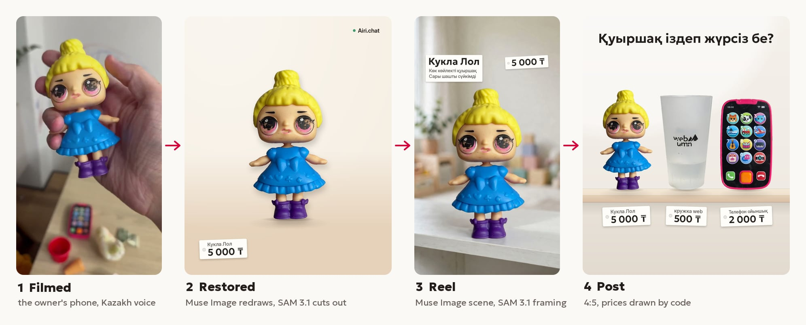
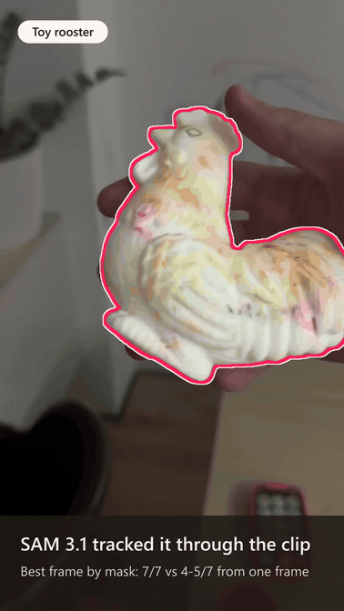
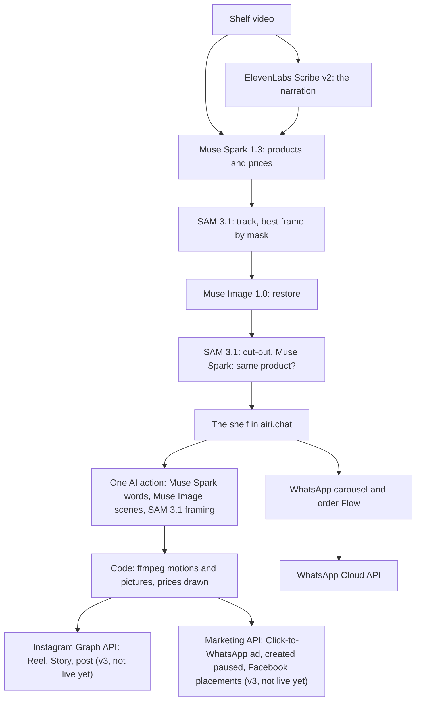

# Film it, sell it

**A shop films its shelf once, saying the prices in its own language. Meta's models turn that one video into products with clean photos and checked prices, then into a video ad and pictures, and one press posts them to Instagram or creates a Click-to-WhatsApp ad (created paused, on Facebook placements), inside the WhatsApp inbox the shop already uses.**

**Live in production on [airi.chat](https://airi.chat) since Oct 29, 2026**, and in its current form since Nov 3: the import, the WhatsApp carousel and order form, and the video ad. Posting to Instagram and the Click-to-WhatsApp ad are studio v3, built and deploying on Nov 4: **not live yet**, and this line changes when they are.

**[Live on airi.chat](https://airi.chat)** · **[Demo video](HACKATHON.md#the-demo-video)** · **[Judge access](HACKATHON.md#try-it)** · **[HACKATHON.md](HACKATHON.md)**: what is new, what existed before



<sub>From our 65-second test video, narrated in Kazakh. The Reel frame and the post are rendered by studio v3's code from the test ad's saved scenes, on a local worker; they are not production posts.</sub>

Our entry to the [Meta Global AI Developer Hackathon](https://cerebralvalley.ai/e/meta-ai-developer-hackathon) (Oct 26 – Nov 4, 2026), Startup track, from the team behind [airi.chat](https://airi.chat). **Theme: Build for Your World.** The small shops we work with sell on WhatsApp and have no product photos. Their owners film on their phones and talk in their own language, so the import takes a narration in any language ElevenLabs Scribe transcribes, with each price in the currency the owner names.

## What Meta's models do

| Meta model | Its job here |
| --- | --- |
| **Muse Spark 1.3** | Watches the silent video with the owner's transcript as text and lists the products, each price with the words it came from (code finds them word for word in the narration), and its doubts. Boxes each product once. Checks that every restored photo and every ad scene still shows the same product, counting missing parts as a difference. Writes the ad's words in the owner's language, with no price in them |
| **SAM 3.1** | Tracks each product through its clip from that one box, so code picks the photo's frame by measuring every mask. Cuts the restored product out. In the ad, boxes the product in its scene, which sets the camera's push-in and where the words stand inside the Reels safe band |
| **Muse Image 1.0** | Restores what the owner's hand, a sticker or the frame's edge hid. Places the real product, unchanged, in each scene of the ad |
| **Muse Spark Open** (open weights, on Baseten) | The prototype's AI seller: finds the product in a buyer's photo on a numbered contact sheet of the shop's cut-outs, in one call. **Built with Muse Spark Open.** |



<sub>SAM 3.1's real masks on the owner's own clip, outlined on every frame; the frame code chose flashes. Made on Nov 4 with the prototype pipeline's own functions and the hackathon key, for about $0.10, tracking at 30 frames a second for smooth motion where the pipeline uses 10.</sub>

Not Meta's, and why: **ElevenLabs Scribe v2** listens, because Meta's own docs say audio understanding in Muse Spark 1.3 is not fully supported, Muse Voice Transcribe's 25 languages include neither Kazakh nor Russian, and in our tests Muse Spark heard nothing in 5 of 9 tries while Scribe got all 7 prices every run. ElevenLabs also turns the background down behind the owner's own voice, and since studio v2 reads new words in Airi's stock voices or, after the owner ticks consent, a clone of the owner's voice. ffmpeg renders the video, and code draws every price.

**Meta platform APIs:** the WhatsApp Cloud API (the carousel template, sent for Meta's review, and the order form, published as a WhatsApp Flow; live). With studio v3, not live yet: the Instagram Graph API's content publishing (Reel, Story, post and carousel) and the Marketing API (a Click-to-WhatsApp ad, created paused on Facebook placements).

## Results

| What | Result | Against | Source |
| --- | --- | --- | --- |
| Cut-outs on the 65-second test video | **7 of 7** clean, at confidence 0.98–0.99, with one Muse Spark box and a SAM 3.1 track | 4–5 of 7 from the sharpest single frame; 4 of 7 boxing one frame | [findings](docs/findings.md#cut-outs-muse-locates-sam-tracks-code-measures) |
| Spoken prices in Kazakh | ElevenLabs Scribe v2: **7 of 7** in every scored run | Muse Spark 1.3 audio heard nothing in 5 of 9; Muse Spark Open 4–5 of 7; Muse Voice Transcribe 6 of 7 on the English dub, the only version it can take | [findings](docs/findings.md#a-dedicated-speech-model-hears-every-price) |
| The AI seller (prototype) | **9 of 9** scripted buyer conversations, twice in a row; a buyer's photo matched in one call | 5 of 9 in its first live run, before the fixes it found | [findings](docs/findings.md#oct-27-the-seller-becomes-an-agent) |
| A production import, Nov 2 | **5 of 5** products, 5 of 5 photos restored by Muse Image, 192 s, $0.28 | Oct 30: stopped after 2 of 5 photos on the $0.50 cap on one AI action; each photo has been its own action since Nov 1 | [findings](docs/findings.md#production-read-on-nov-4) |
| Production video ads, Nov 3 | **2**: $0.076 in 95 s, and $0.090 read by an Airi voice | the local test: $0.07–0.08 in 64–79 s | [findings](docs/findings.md#production-read-on-nov-4) |
| Words inside the Reels safe band | **9 of 9** inked layers on both test ads | | [findings](docs/findings.md#rendered-again-with-the-final-code) |
| Instagram posts, and Click-to-WhatsApp ads created paused on Facebook placements, in production | **0 and 0** so far: studio v3 isn't live yet | | [findings](docs/findings.md#production-read-on-nov-4) |

## How it works



[docs/architecture.md](docs/architecture.md) has each step, the Instagram post's states and the ad's state machine; [docs/findings.md](docs/findings.md) has every measurement; [HACKATHON.md](HACKATHON.md) lists every hackathon commit and what existed before.

- `airi/`: airi.chat, our existing product, imported as pre-existing code. The hackathon's product work happens inside it, in later commits that HACKATHON.md lists. It is a separate pnpm workspace.
- `apps/`, `packages/`, `scripts/`: the prototype written at the start of the hackathon, with the experiments and the AI seller on Muse Spark Open.

## Status

**Live:** the Products section has run in production on [airi.chat](https://airi.chat) since October 29, 2026, behind the `products` flag, which is turned on per workspace; so far only in our own Airi.chat workspace. Its first import there, our own test on October 30, stopped after 2 of its 5 photos; the fix, which makes each photo its own AI action, went live on November 1. Narration in any language ElevenLabs Scribe transcribes, with each price in its own currency, went live on November 2. The Products studio went live on November 3: the import on a light stage that shows "What you said", a WhatsApp carousel and order form made in one press, and a video ad made from shelf products with Muse Spark, Muse Image and SAM 3.1. Later on November 3 came airi.chat's pull request 509 (the carousel waits longer for Meta) and studio v2 (the kit in airi's own WhatsApp editors, the ad's new openings, pictures and voices).

**Not live yet:** studio v3, built in airi.chat's branch and deploying on November 4. One page: picks on the shelf drop onto template tiles grouped by where they go on Meta, and each result has one Meta action, **Post Reel**, **Post Story**, **Post**, **Post carousel**, **Create ad** or **Create on WhatsApp**. Studio v2 and v3 are not yet ported into this repository's `airi/`; [HACKATHON.md](HACKATHON.md#in-production) says what each holds.

On October 27 the project moved inside airi.chat, where shop owners already run their WhatsApp number. The standalone prototype at the root stays as the experiments and the first working version, which expects prices in tenge.

**Inside airi.chat** (`airi/`):

- **Products section** for workspace admins: products shown as cut-outs standing on a shelf.
- **Meta Model API client:** Muse Spark, Muse Image and SAM 3.1, with timeouts, retries and the cost of every call.
- **Video-to-products pipeline:** on the 65-second test video, all 7 products found with the right spoken prices, and all 7 photos restored by Muse Image (the owner's hand removed, the product upright on a plain backdrop, then cut out), in about 2.5 minutes for $0.36.
- **Import job:** a Temporal workflow runs the pipeline for each uploaded video, saves every step so a retry resumes without paying again, counts its model calls against the workspace's AI spend limit, and shows products live as they arrive.
- **Products as the shop sells them:** a product is one name at one price, said or written on screen, and every item shown for it (several designs, sizes or shapes, or the panels and clocks of one sentence) is one of its options, with its own photo. The shelf shows the featured option.
- **Videos that don't follow the brief:** owners don't always film the way they're asked. An edited promo with cuts, a presenter, subtitles and price stickers works too: tracking never crosses a cut, Muse checks every crop shows the product before it's restored, subtitles, people and neighbouring items are removed, a product filmed at a slant is levelled to horizontal or vertical, ends the frame cut off are completed to match, a buyer's name hidden under a sticker becomes a default name the owner is told about, the background shows through holes and openwork, prices only written on screen and "from" prices are read and flagged, and the person presenting is kept as a cut-out, without the subtitles over them, to reuse later.
- **Upload on the Products page:** choose or drop a video; it goes straight to storage with its progress shown, after the page checks it's a video of 5 minutes at most. Then the page follows the import live: each stage, and the products it finds landing on a dashed shelf as their photos are made. It also shows imports started elsewhere, and why one failed.
- **Swipe-through review:** one card per product, with a round clip of the owner saying its price. What Airi isn't sure of is in red with why. Swipe right (or →) to add it to the shelf, left (or ←) to skip, undo, or accept all; tap the name or price to fix it, or choose which item the shelf shows.
- **Carousel + order form in one press:** for products picked on the shelf, "What buyers see" previews a carousel template (the products on white cards) and an order form, both written for buyers in Kazakh, Russian or English, following the owner's narration (English for any other language), with each price in the currency the owner said or showed. One press makes both, with no AI actions: the carousel goes straight to Meta for review, and the order form is published as a WhatsApp Flow. The page lists each one, with Meta's status.
- **Video ad:** 1 to 3 shelf products become a 9:16 video, in the language the owner spoke (Latin and Cyrillic letters only for now), for 1 AI action. Muse Spark 1.3 writes the words and checks that each scene still shows the same product, Muse Image 1.0 places the real products in scenes, SAM 3.1 frames each product in its scene, which sets the camera's push-in and where the words stand inside the Reels safe band, and the presenter's SAM 3.1 cut-out can close the ad once the owner ticks that they agreed. Code draws the prices from the shelf. In this repository's copy the voice is the owner's own, from the video; studio v2, live in airi.chat but not yet ported here, adds Airi's stock voices and a clone of the owner's voice (ElevenLabs), after a consent tick. With the video come a Status picture, a 4:5 ad picture, the post text and Click-to-WhatsApp ad copy. On two real videos, a full make cost about $0.07–0.08 and took about 64–79 s, or $0.09 and 105 s when a scene needed its second try; in production on November 3, $0.076 in 95 s ([docs/findings.md](docs/findings.md)).
- **Videos sent on WhatsApp:** link your phone once from "Send from WhatsApp" on the Products page: scan the QR, send the message it writes (it names the shop and holds nothing secret), and confirm the phone on the page. A number already connected to the workspace counts as linked. Then send shelf videos to Airi's number. Their products appear in airi, and Airi writes back once per video with the link to check them.
- **Each photo its own AI action:** our first test import in production stopped after 2 of 5 photos, because the whole video was one AI action under the $0.50 cap on an action. Now reading the video is one action and each photo another, at honest prices. If the company's AI allowance runs out partway, the import still ends with every product it found and says how many photos weren't made; a refusal caused only by the import's own photo reservations no longer stops the photos.
- **A stage that shows the models at work:** while a video is imported, a light sheet shows its real first frame, five steps naming who does each (Airi prepares the video, ElevenLabs Scribe v2 listens, Muse Spark 1.3 watches, Muse Spark, SAM 3.1 and Muse Image 1.0 make the photos, the owner checks), and "What you said": the owner's own words for each product, with the name and price made of them and its photo's state. The products then stand on a shelf drawn like a real one, in a calm paper look with a warm dark mode.
- **Any language, any currency:** owners narrate in their own language and name the currency at least once. No language is set: ElevenLabs Scribe v2 works out which one is spoken (ElevenLabs lists 90+ languages for it). Each price keeps the currency said or shown for it and that currency's decimals (4.99 USD, 1 500 JPY), and a currency said once covers the video. A price whose currency was never said or shown, or one in a second currency, is flagged for the owner to set on its card. Tested on real Kazakh recordings, on synthetic English and Japanese voice-overs of the shelf video, and on real Scribe transcripts of short synthetic clips in 10 languages ([docs/findings.md](docs/findings.md)).

**Prototype** (root), not part of airi.chat; it runs locally:

- **Studio:** the owner uploads a video, watches the shelf being built, fixes names and prices, and confirms products.
- **Shop page:** buyers see the confirmed products with their price tags and chat with the AI seller, an agent built with Muse Spark Open that searches the shelf, matches photos, shows product cards, and places and looks up orders. Orders and questions it can't answer reach the studio. The chat says "Built with Muse Spark Open" under its title.

## Try it on airi.chat

Access for judges is in our submission form, and [HACKATHON.md](HACKATHON.md#try-it) has each step in full. These are studio v3's steps; it is **not live yet** and deploys on Nov 4.

1. On **Products**, tap the **+** at the end of the shelf, or drop a shelf video of about a minute on the page: hold each product up and say its name and price in your own language, naming the currency at least once.
2. Watch the import on its stage. Its products land in a row on the shelf, with the first 3 picked; tap products to change the picks.
3. Drop your picks on a template tile, or tap one: Reel, Story, Post, WhatsApp ad or WhatsApp chat. The first video or picture tile makes the ad, in about a minute and a half; the other tiles reuse it at no cost.
4. In the workbench, change the shots, the look or the voice. Its one button posts to Instagram, creates a Click-to-WhatsApp ad (created paused, on Facebook placements) or creates the WhatsApp carousel and order form. The judge workspace has none of those accounts connected, so it shows **Connect Instagram**, **Connect Meta Ads** or **Connect WhatsApp**; please don't connect your own. The demo video shows each action on our own workspace.

## Run the prototype

After [Setup](#setup):

```bash
pnpm shop:create "QazOner Group"   # prints the owner's studio link and the shop page link
pnpm dev                            # server on :8787, studio and shop on http://localhost:5173
```

In the studio, upload a shelf video and confirm the products it finds. The shop page then shows them, with the AI seller in its chat; the chat is off without a Baseten key.

Data (the SQLite database, uploaded videos, cut-outs) lives in `.data/app/`, which git ignores.

## Setup

Requires Node.js 24, pnpm 11 and ffmpeg.

```bash
pnpm install
cp .env.example .env
git config core.hooksPath .githooks
```

Put your keys in `.env`: the Meta Model API key, an ElevenLabs key for speech, and a Baseten key for the AI seller on Muse Spark Open. Without Baseten's hackathon approval, set `BASETEN_MODEL=meta-models/muse-spark-open` in `.env`: the hackathon ID it ships with, `meta-models/muse-spark-open-1026`, answers 404 until Baseten approves your account. Every commit subject starts with `meta-ai-hackathon: `.

## Build a catalog from a video

```bash
pnpm catalog path/to/shop-video.mp4
```

Prints the transcript and every product with its price and the words the price came from, and writes cut-outs and a contact sheet to `.data/catalogs/`, which git ignores.

## Check the AI seller

```bash
pnpm seller:eval   # scripted buyer conversations against the latest catalog, each reply checked in code
```

## Experiments

```bash
pnpm spike:speech path/to/video.mp4 --expect=prices.json   # score speech models against real prices
pnpm spike:sam path/to/video.mp4 "medal"                   # track one kind of product through a video
```

What the experiments found is in [docs/findings.md](docs/findings.md).

## Checks

```bash
pnpm typecheck
pnpm test
```

CI also checks the hackathon's code inside airi.chat: the `airi` job in [.github/workflows/ci.yml](.github/workflows/ci.yml).

## License

[Apache-2.0](LICENSE). The prototype's AI seller is built with Muse Spark Open, under its own licence ([model card](https://huggingface.co/meta-models/Muse-Spark-Open-816B-A42B)).
