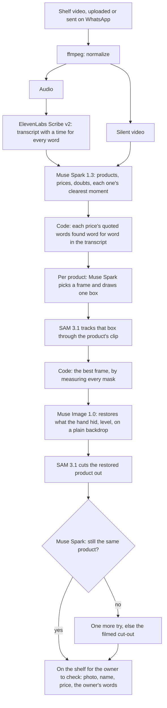
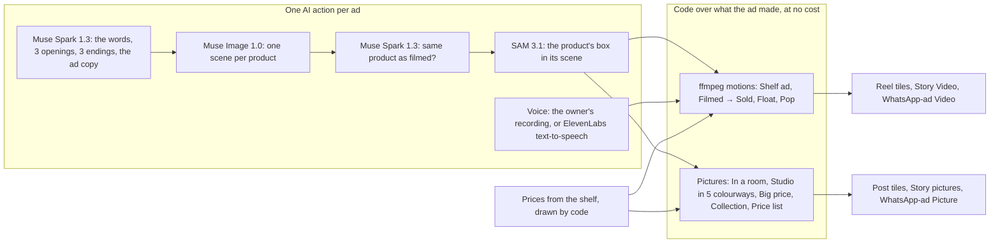
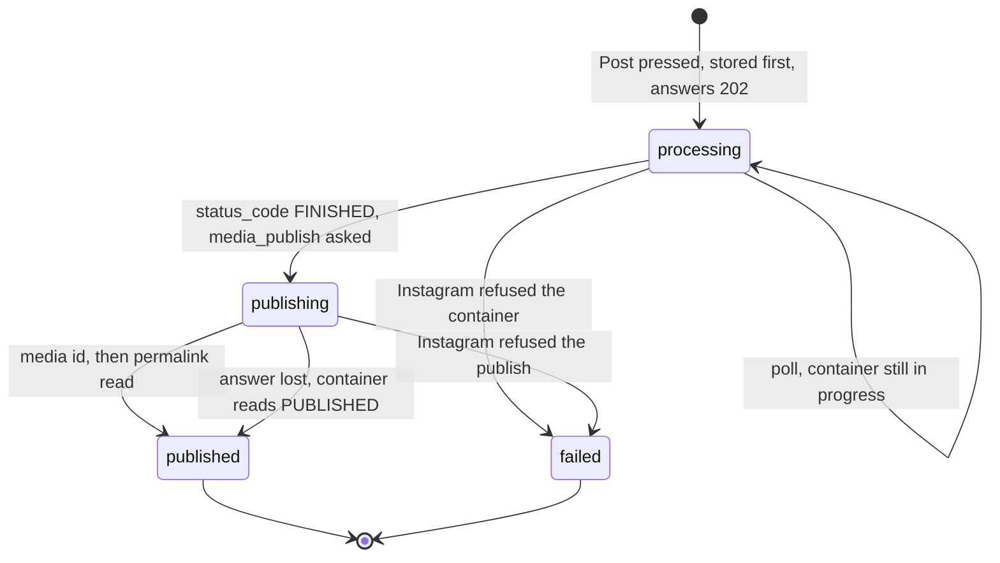
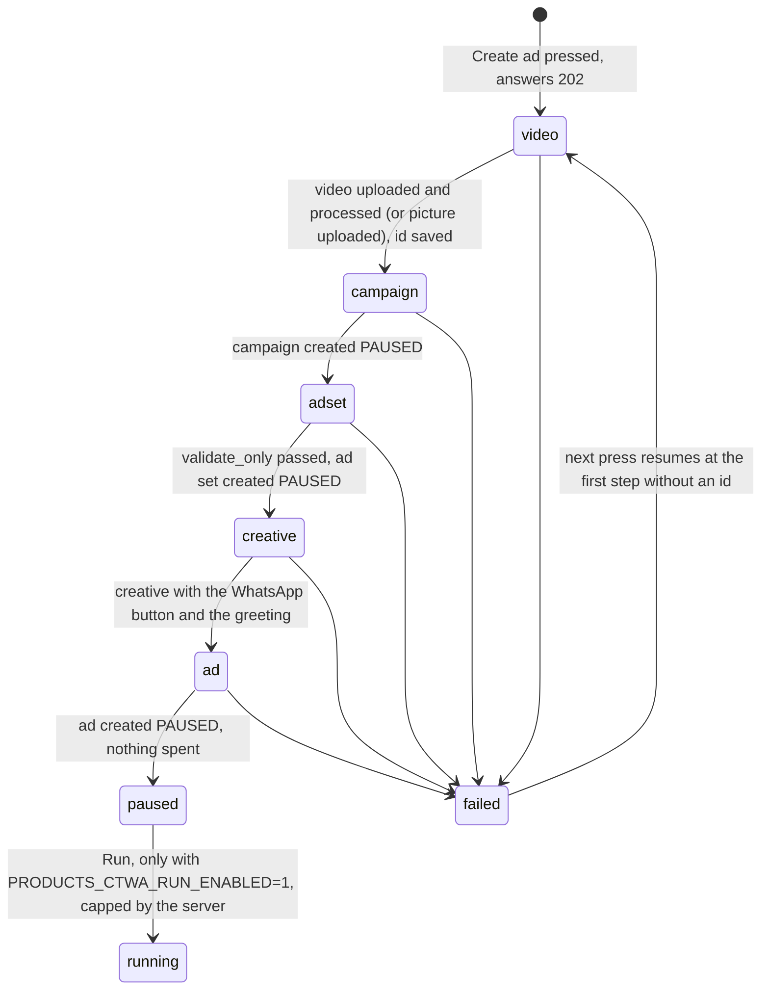

# Architecture

A shop films its products once, saying the prices in its own language. Meta's models, with ElevenLabs Scribe for the speech, turn the video into a catalog of clean product photos and prices, each in its own currency, and the shop sells from it on WhatsApp. From the catalog, one press makes a WhatsApp carousel and order form, and one AI action makes a short video ad with its pictures. Studio v3, live since November 4, adds the last step: each result goes out on Meta in one press, as an Instagram post or as a Click-to-WhatsApp ad created paused on Facebook placements.

## Where the work lives

The project started as a standalone prototype and, on October 27, moved inside [airi.chat](https://airi.chat), our existing WhatsApp product. Shop owners already run their business number in airi.chat, so the video import is a new section there instead of a second app they would have to adopt. [HACKATHON.md](../HACKATHON.md) lists every commit that built a feature, links the full history, and says what existed before.

| | Where | What it is |
| --- | --- | --- |
| Prototype | `apps/`, `packages/`, `scripts/` at the root | Written during the hackathon. The experiments behind [findings.md](findings.md), the first pipeline, a studio and shop page, and the AI seller on Muse Spark Open. It runs on its own from this repository and expects prices in tenge. |
| Product | `airi/` | airi.chat, imported as pre-existing code (as of Oct 27, the morning after kickoff). Hackathon work inside it arrives only in later commits, each listed in HACKATHON.md: the Products section, with the Meta Model API client, the video import, the review, the WhatsApp drafts and videos sent to Airi on WhatsApp, and the studio: the carousel and order form made in one press, and the video ad. It has run in production since October 29, and the studio since November 3. Pull request 509, studio v2 (live since November 3) and studio v3 (live since November 4) are airi.chat's later pull requests, ported into `airi/` on November 4. |

## Who uses what

| Who | Where | What they do |
| --- | --- | --- |
| Shop owner | **Products**, a section of airi.chat for workspace admins | Film the shelf, check the products Airi found, and make from them a WhatsApp carousel and order form, or a video ad with its pictures; with studio v3, post a result to Instagram or create a Click-to-WhatsApp ad (created paused, on Facebook placements), one press each |
| Buyer | **WhatsApp**, on the shop's own number, connected to airi.chat | See products in carousels, ask, order |
| Judges | **Products** on airi.chat, with the access in our submission form ([Try it](../HACKATHON.md#try-it)), and the prototype run locally | Upload a shelf video, follow its import, check the products and see the shelf, see what buyers would get, and make a video ad; with studio v3, see the Meta actions' Connect states, since the judge workspace has no Instagram, Meta Ads or WhatsApp connected; ask the prototype's AI seller in its shop page's chat |

Built in airi.chat during the hackathon: the Products section, the Meta Model API client, the pipeline, the import job that runs it, uploading from the Products page with the import followed live on a stage that names the model doing each step, the review, the WhatsApp drafts, and sending a video to Airi on WhatsApp. After our first test import in production, on October 30: each photo its own AI action, and phones linked once an admin approves them. Live on November 2: a narration in any language Scribe transcribes, each price in its own currency, and photos that no longer stop at the import's own reservations. Live on November 3: the Products studio, with the import on a light stage that shows "What you said", products picked on the shelf, the carousel and order form made in one press, a list of what was made, and the video ad; then pull request 509, which gives the carousel longer to reach Meta, and studio v2, with the kit in airi's own editors and the ad's new words, pictures and voices. Live on November 4: studio v3, the one page with its Meta actions ([below](#studio-v3-one-page-and-meta-actions)).

On the Products page the owner chooses a video or drops it on the page. The page checks it first (a video, at most 5 minutes and 1 GB, the import's own limits), then uploads it the way the Assets page does, straight to storage through a signed link, showing the bytes sent. Once the import starts, the page follows it: the job announces each step on the workspace's realtime channel, and the page also asks again every 10 seconds while it runs, in case an event is lost. The products the job finds stand on a dashed shelf, each photo landing as it's made, until the owner checks them. The import plays on a light sheet of the page's paper: the video's real first frame; five steps naming who does each (Airi prepares the video, ElevenLabs Scribe v2 listens, Muse Spark 1.3 watches, Muse Spark, SAM 3.1 and Muse Image 1.0 make the photos, the owner checks); and "What you said", a ledger of the owner's own words for each product, with the name and price Muse Spark made of them, the price set apart, and its photo's state. Nothing on it moves on its own: the time ticks, counts change and photos land. The page shows imports started anywhere (another device, or WhatsApp later): running ones, ones with products left to check, and for a day those that failed or found nothing, with why.

Checking them is a card stack, one card per product, the way dating apps work. A card shows the product's photo (polished, or as filmed), its name and price, and a round clip of the owner saying the price, like a video message in a chat app. The import job cuts that clip from the video with its own sound: from the transcript's time mark just before the price's words to the next mark or sentence, 2 to 6 seconds, or 4 seconds around the item when the price was only on screen. What Airi isn't sure of is in red, with why. Our checks of the price against the narration, and the model's doubts that name a price, are about the price, and setting it settles them. Swipe right (or →) adds the product to the shelf, left (or ←) skips it; undo brings the last one back, and "Accept all" adds the rest. A tap fixes the name or price in place, or chooses which of a product's items the shelf shows. Decisions show at once and are saved behind, in the owner's order; one the server refuses comes back, and the card says so. The review has its own address (`?review=<import>`), so the link Airi will send on WhatsApp can open it, and Back closes it.

The carousel and order form are made from products on the shelf: in the studio as it went live on November 3, from the review's last screen or from products picked on the shelf; in studio v3, from the WhatsApp chat tile, whose button is **Create on WhatsApp**. "What buyers see" previews the carousel and the order form from the real products, written for buyers in Kazakh, Russian or English, following the owner's narration, and in English for a narration in any other language, with each price in its own currency; the owner can choose another of the three languages. One press makes both, as a kit, with no AI actions. The server makes both parts at once and saves each as it settles, so a part that worked is never undone by the other failing, and the same press sent again answers with the kit it made. What buyers read is written in one place, so the preview says exactly what Meta gets:

- **Carousel:** the first 10 products with photos, each on a card with its cut-out centred on a white square JPEG (Meta crops every card to the first one's shape), its name and price, and an order button, under a short message. The pictures are stored in airi's media as template header samples, the way the template editor's own uploads are, and the carousel goes straight to Meta for review the way the template editor sends one, so it shows in Templates too. While a page shows the kit, Meta's verdict is read again: from airi's Templates rows, which Meta's status webhooks keep current, and from Meta itself once they have said "waiting" for 2 minutes. Once Meta approves it, the owner sends it from a scenario or a bulk campaign; the press itself sends nothing to buyers.
- **Order form:** a one-screen WhatsApp Flow with up to 20 products to tick (their prices beside them), the buyer's name, a delivery address and a comment; WhatsApp already gives the buyer's number. It is built with the Flow JSON generator and validator airi's scenario builder uses, created empty on the workspace's WhatsApp Business Account and then given its JSON, as airi's Flow provisioning does, and then published. A draft whose JSON Meta refuses is deleted rather than left broken, and a Flow Meta won't publish stays a draft for the owner to publish in WhatsApp Flows. Meta lets a published Flow be deprecated but not deleted, so each press that makes the order form publishes another.

A kit says when a shelf price changed since a part was made, and when Meta's template limit stopped the carousel. "Try again" makes one part again, first finding what a lost attempt already made at Meta: a template under the same name, or the Flow whose id was saved as soon as Meta made it. The page lists every kit, with Meta's status on its carousel, and every video ad; in studio v3 that list is **Out on Meta**, which shows only what exists at Meta, each with its status and link.

Owners can also send the video to Airi on WhatsApp, at airi's own number (set in `PRODUCTS_WHATSAPP_NUMBER`), from the phone they filmed it on. First the phone is linked to the workspace: "Send from WhatsApp" on the Products page shows a QR to scan and a link to tap, which opens WhatsApp to Airi with a message naming the shop written in, the way airi's website carts hand off to WhatsApp. The message holds nothing secret, so sending it only asks: the phone waits, masked, until an admin taps "Yes, link it" on the Products page. A phone linked to one shop is never moved to another, and a shop opens to phones only under a name no other shop with Products has. A number the workspace already has connected to airi counts as linked without asking. A video from a linked phone within 30 minutes of linking, or of its last video, becomes an import at once; a later one gets one question with two buttons, in case it wasn't meant for the shelf. Videos sent together share that question: WhatsApp delivers an album as one message per video, after a marker the Cloud API reports as an unsupported message, so a video within two minutes of the one before joins the question, and "Add them" adds them all. Everything else sent to that number gets the number's usual handling. The handler sits in airi's webhook runtime right after the message is saved, so the conversation still shows it, but Airi's assistant doesn't answer it. The import job fetches the video from WhatsApp as its first step, keeps a copy in the owner's media for retries, and runs as for an upload. WhatsApp's standard quality is enough: sent that way (576×1024, about 1.3 Mbps), the shelf test video still gave all 7 products with the right prices and 7 restored photos, and QazOner's promo (shown with QazOner's permission) its 4 products with their starting prices. When it ends, Airi writes once: how many products it found and the link to check them, or why the video couldn't be read. There is no "got it" message, since every message after the free 1,000 a month is paid; the page shows the import's progress.

Apart from that one question about a late video, the owner makes no decisions inside WhatsApp. Since October 1, 2026, Meta bills every service message after the first 1,000 per number each month ([Meta's WhatsApp pricing](https://developers.facebook.com/docs/whatsapp/pricing)), so a review dialogue in chat would cost money on every tap. The Products section does the same job for free.

## Message costs

Today's AI seller is the prototype's web chat on its shop page, which sends no WhatsApp messages. Moving it to WhatsApp is the plan. There, every AI reply to a buyer would be a paid service message once the number's free 1,000 a month are used up, so the plan is to send as few as possible:

- One rich reply per buyer turn: a carousel shows up to 10 products in a single message.
- No "thinking…" or acknowledgement messages.
- Messages per order, tracked as a cost metric.
- Buyers who arrive from Click-to-WhatsApp ads answered while Meta's free entry point window is open, when replies aren't charged.

## Pipeline

Products are grouped the way the shop sells them. A product is what a buyer orders by one name at one price, said aloud or written on screen as a headline; every item shown for it, such as several designs, sizes or shapes, or the panels and clocks named in one sentence, is one of its options, with its own photo. The shelf shows the featured option: the item shown as the narration reaches "today" when it tells how something began, otherwise the item presented for sale, otherwise the clearest. Long sentences carry time marks inside the transcript, so Muse can tell which words went with which shot.

Owners don't always film the way they're asked, so the pipeline also takes an edited promo: cuts between scenes, a presenter talking to the camera, products shown behind them, headlines, subtitles and price stickers. An item's frame is only chosen from the shot Muse picked (a cut is a jump between frames many times bigger than the change around it, so a hand swinging a product doesn't count); Muse confirms the crop shows the item before anything is restored, and falls back to SAM on Muse's own frame when it doesn't. People are taken out of the item's mask before it's measured: a presenter's white blouse taken in with a white medal holder had hidden its slant. An item filmed at a slant is levelled to horizontal or vertical, whichever is nearer, from the tightest rectangle around its outline and once Muse agrees it looks right, before Muse Image restores it (a quarter turn between the two later needs no redrawing); an item the frame cuts off gets room around it, and Muse Image completes its ends to match.

Muse Image restores the item evenly lit on a plain colour it has little of: a flat grey, white for an item with noticeable grey, or charcoal for a light item whose own shading is grey (on grey, a white holder's shaded plate tore its slots when cut out). It removes subtitles, stickers, people and neighbouring items and keeps openings open; the backdrop showing through holes and openwork is then cut away, where a region sits on the backdrop's colour on average and not just near it, so grey lettering and dark prints stay. Along the item's outline, opacity is read from colour, so no rim of backdrop shows on a light or dark page. Muse Spark first reads the item's lettering, and words the video hid are written in: a buyer's name under a price sticker becomes a default full name, Kazakh or Russian for a narration in those languages and English otherwise (and the owner is told), other hidden words Muse Spark's best guess. A personalised item's few pieces of lettering are all written out, so no guess at the half of a name that showed survives; on a family tree with many names only the hidden ones are, and the rest are kept (dictating them all made Muse drop name plates). A restore the same-product check rejects (a video caption drawn onto the item counts), or a safety filter refuses, is tried once more; when both fail, the filmed photo is used, without the people.

Prices only written on screen are taken with a note to confirm, starting prices ("from 15 500") are marked so the shelf says so, a price said once for several products is flagged on each of them (told apart by the sentence it was said in), and counts like "26 000 families" aren't taken for prices. Prices aren't tied to one country. Each keeps the ISO currency said or shown for it, and a currency said once covers the video's other prices. A price whose currency was never said or shown stays bare and is flagged for the owner, who sets it with the amount on the card; a price in a second currency is flagged too. Prices keep their currency's own decimals (4.99 USD, 1 500 JPY, 1.250 KWD). The check reads decimal commas and points, thousands, lakh and Swiss grouping, and digits of any script. A quoted number must occur in the narration in full, not inside a longer one ("500" isn't found in "1 500", nor 五百円 in 千五百円), and a price written in digits must equal it. The person presenting is cut out, without the subtitles over them, and kept with the import.

On QazOner's 36-second promo, shown with QazOner's permission and filmed as an advert rather than to the brief: 4 products as the shop sells them (шежіре from 15 500 in 6 designs, 5 to 8 across runs; the medal holder from 16 900, levelled from a 37° slant, its cut-off end completed and its hidden name written as an example; ethno panels and clocks from 15 500 in 4 items; and the dancing table from 35 000), every price right and marked as a starting price, all 12 photos restored, and the presenter kept; 6.5 minutes and $0.72. The 65-second shelf video still gives 7 products with 7 restored photos, for $0.45.

In airi.chat the pipeline is in the Temporal worker, `airi/apps/temporal-worker/src/media/product-video/`, run by one import job per video. The job saves each step as it finishes (the transcript, the draft products, each photo, each product's review clip), so a retried job resumes instead of paying again, and the panel hears live as each product's photo lands. On the 7-product test video it found all 7 products with the right prices and restored all 7 photos, in about 3 minutes for $0.37 of Meta calls; a retry after that took 11 s and paid nothing.

## Video ad

A video ad is made on the media worker from 1 to 3 shelf products, each with a cut-out photo and a price. The web checks the owner's brief first: the products are on the shelf, every product name and price, and the owner's own idea, uses letters the ad's fonts draw, and the workspace's AI allowance can admit an action, or it gives the import's own reason (the company's spending limit, the plan's included actions, or the free trial). Then one Temporal workflow per render (`productAdWorkflow`, on the `airi-media` queue beside the imports) runs one activity, which saves every step on the ad as it finishes, so a retried run (3 attempts at most) skips what's done and pays only for what isn't.

1. **Words (Muse Spark 1.3).** One call with a strict JSON schema writes, in the language the owner spoke: the first scene's sticker, a caption and a setting for each product's scene, the price card's title, the ending, the post's opening, and the Click-to-WhatsApp copy (a headline, primary text, a greeting and 3 quick questions). It sees each product's photo and the narration about it: the line with its price quote, the line before, and the line after only while the product's own clip still runs, leaving out a line where another of the ad's products has its price said. Code checks the answer: no digit, currency sign or price said in words, Kazakh written with Kazakh letters, every product once, and every text within its room (on screen, lines of 26 characters, 2 at most; for the ad copy, Meta's limits). A failing answer gets one repair call with the problems listed; after that, code writes plain words itself, so an ad always has words. Since studio v2, the same call also writes 3 openings and 3 endings for the owner to pick from, and a spoken line for each scene, with no price in it, for a voice that reads new words.
2. **Exact stills first (no model).** Each product's cut-out is set on a paper wall and plank drawn in code, and the price card, with every product on the plank under its paper price tag, becomes the Status picture. So a result exists before any picture is paid for.
3. **Scenes (Muse Image 1.0, checked by Muse Spark 1.3).** Up to 3 at a time, Muse Image places the product's restored photo, unchanged, in the setting the words chose: the whole product upright in the lower half of a 1024×1536 picture, about half its height, with a calm wall above it for the words, and no text, prices, logos, people or hands. Muse Spark then compares the scene with the product as filmed. A mismatch gets one more try, with the difference it named added to the prompt, and so does a Muse Image outage or a check that couldn't run; Muse Image refusing the scene, the ledger refusing its spend, or no passed check after the two tries leaves the exact still ("Your exact photo"), so a price is never shown on a product that isn't the owner's. Since studio v2, the owner can ask for a **New picture** of one scene, in one of 5 tested places or in a place they describe, which Muse Spark reads first and refuses when it asks for people or anything unsafe; up to 4 earlier pictures of a scene can be picked again for free.
4. **Framing (SAM 3.1).** SAM boxes the product in each Muse Image scene. A box much flatter than the cut-out's own shape (in our paid test, SAM boxed a table's top without the deer standing on it) grows up to the whole product. The box sets the 9:16 crop, the point the camera pushes in on, and whether the words stand above the product or below it. Without a box, the scene is cut around its centre.
5. **Voice.** With "Your voice, from the video", the stretch each product's review clip plays, the owner saying its price, is cut from the import's video with its original sound. The clips go to the ElevenLabs Voice Isolator in one call, padded with silence to 5 s when shorter (it refuses a recording under 4.6 s), and ffmpeg's FFT denoiser steps in when the isolator's answer can't be used. Then ffmpeg cuts rumble and evens the voice with EQ and gentle compression, code tightens long pauses with a short fade at each cut, and ffmpeg normalises the track to about −16 LUFS and −1.5 dBTP; a product with no clip is silent. In this repository's copy that is the only voice, and none is synthesised. Studio v2 (live in airi.chat since November 3, not yet ported here) adds synthesised voices: each scene's spoken line, with the price said after it in words that code writes from the shelf, is read by ElevenLabs text-to-speech in one of Airi's stock voices, or in the owner's own voice, an ElevenLabs Instant Voice Clone made from up to 75 s of the import's narration (cleaned by the Voice Isolator first) only after the owner ticks consent. The clone has no price of its own, and **Remove my voice** deletes it at ElevenLabs. Every voice is booked in the ad's one AI action.
6. **Render (no model).** ffmpeg pushes each scene in on its product, brings in its paper label and drops in its price tag, and slides from one product's scene to the next in 0.35 s; the price card and then an ending, each faded in, close the ad. The ending carries the words' call to write on WhatsApp, a pill with the connected number or the shop's name, and, only when the owner ticked that they agreed, the person presenting in the video, whom SAM 3.1 cut out during the import. The words are set in Geologica and Inter, bundled with the worker under their OFL licences. Out come a 1080×1920 H.264 MP4 with AAC sound, at 30 fps with faststart, its poster, the Status picture, and a 4:5 ad picture of the first scene at 1080×1350. Code composes the post text: Muse Spark's opening, a "name — price" line for each product, the ending with the number or the shop's name, and "Pictures made with AI." in the post's language when a scene is Muse Image's.

What every ad keeps to:

- **Prices are never generated.** Code draws each price from the shelf on a paper tag. The words are checked for digits, currency signs and prices said in words, Muse Image is told to add no text or prices, and a scene Muse Spark didn't pass is never shown.
- **The words stay inside Meta's Reels safe band.** At 1080×1920, the top 14% (269 px), the bottom 35% (672 px) and 6% (65 px) on each side hold the app's header, caption and buttons, so every word layer stands inside the rest, and a price tag drops in only as far as keeps its ink inside it. The 4:5 picture keeps a 64 px margin. The layout's tests check every layer wherever the product stands.
- **Under WhatsApp's 16 MB.** The video is rendered at 1080×1920 and CRF 21, again at CRF 25 when that's over 16 MB, then at 720×1280; if it's still over, the ad fails as too big rather than leaving a file WhatsApp won't take.
- **Only letters the fonts draw:** Latin and Cyrillic (Kazakh's included), digits, punctuation and ₸. The web refuses a brief with any other, and a glyph test checks every allowed code point against both fonts.

**One AI action per ad.** Every paid call of every run books to the ad's one action, `product-ad:<adId>`, so a retry or a re-render never counts another included action. Each call reserves before it runs, under an operation id unique to its run and attempt, and settles what it cost after, the way the import books its photos: $0.04 reserved for a call for the words, $0.01 for a scene or a check, $0.0025 for a SAM box, and the Voice Isolator's list price of $0.12 a minute, $0.01 at least. A call that failed after it may have been billed keeps its whole reservation. The first reservation admits the action; if the ledger refuses one after that, the rest of the ad falls to code (the exact stills, the denoiser, and the code's own words if none were written yet), and the ad still finishes. Editing the words starts a render-only run, which calls no model and spends nothing, and "Try again" after a failure picks up where the ad stopped, reusing the pictures already made.

On two real videos, through this pipeline on a local worker with the hackathon keys, a full make cost about $0.07–0.08 and took about 64–79 s (or $0.09 and 105 s when a scene needed its second try), and a render-only run after editing the words took 13–19 s, for $0 ([findings.md](findings.md)). In production, on November 3, two ads of 3 products each took $0.076 in 95 s, and $0.090 with an Airi voice ([findings.md](findings.md#production-read-on-nov-4)).

## Studio v3: one page and Meta actions

**Live since November 4, 05:56 UTC,** as airi.chat's pull request 512. Its code is in this repository's `airi/`: the paths below are relative to `airi/apps/web/src/`, or to `airi/` when they start with `apps/`.

**One page.** Each video is a row on the shelf, newest first, headed by a small print of the video. When an import finishes, its first 3 products are picked; a tap picks or unpicks a product, which then shows its number, and the picks live in the page's address. Below the shelf, template tiles are grouped by where they end up on Meta: Reel, Story and Post (Instagram), WhatsApp ad (a Facebook ad that opens a WhatsApp chat) and WhatsApp chat. Each tile is drawn in CSS from the owner's own cut-outs and filmed frames, so it costs nothing and redraws as the picks change. Dropping the picks on a tile, or tapping it, makes the result: one code path for both. The tile catalog is one static file, `lib/products/templates.ts`. A tile is a template plus a destination, so its workbench has exactly one Meta action, and a tile is shown only when its renderer is deployed (`shipped: true`). All 15 tiles in the catalog ship, as deployed (`grep -c "shipped: true"` on `lib/products/templates.ts`; 9 did before airi.chat's `9e5505511`):

| Group | Tiles that ship | Made from | Its one Meta action |
| --- | --- | --- | --- |
| Reel | Shelf ad, Filmed → Sold, Float, Pop | the ad's video, in that motion | **Post Reel** |
| Story | Video, Price list, Big price | the ad's video; its Story pictures (stills) | **Post Story** |
| Post | In a room, Studio, Big price, Collection, Carousel | the ad's pictures (stills) | **Post**, **Post carousel** |
| WhatsApp ad | Video, Picture | the ad's video; its In a room picture | **Create ad** |
| WhatsApp chat | Carousel + form | the products' cut-outs, with no AI action | **Create on WhatsApp** |

**One AI action, many formats.** The first video, picture or WhatsApp-ad tile for a set of picks makes the ad, as one AI action, exactly as in [Video ad](#video-ad). Every other one of those tiles reuses that ad: a different motion is a render with no model, and the pictures are drawn by the same render. In production that one action has cost $0.076–0.090 ([findings.md](findings.md#production-read-on-nov-4)); the motions and pictures cost nothing more.

- **Motions** (`apps/temporal-worker/src/media/product-video/ad/render.ts`, `compose.ts`): Shelf ad is v2's push-in on each scene. Filmed → Sold opens each shot on the product as the owner filmed it, from the import's original frame, then wipes to the made scene. Float sets the exact cut-out on its own layer over the scene's wall, bobbing on a 2 s wave with its shadow breathing in step; Pop blurs the scene behind the cut-out and grows the cut-out once, from 100 % to 108 % in 0.6 s.
- **Pictures** (`apps/temporal-worker/src/media/product-video/ad/stills.ts`): every still is a JPEG, 1080×1350 for a post or 1080×1920 for a Story, drawn by code over what the ad made, with the shelf's prices set as text: In a room (the product's scene), Studio (the exact cut-out on a code-drawn sweep in 5 colourways, its shadow cast from its own shape), Big price (the price huge, the product standing in front of it, as a post and as a Story), Collection (every product on one plank with its tag) and Price list (a Story with every product, a dotted leader to its price, the shop's name, the ad's ending and its WhatsApp line). The Carousel post is Collection, then one picture per product.
- **The workbench** opens under the tile, with the result in the frame it will appear in: a Reel or Story frame, a 4:5 post, a Facebook feed ad with its WhatsApp button, or a WhatsApp chat. Its rails are pictures only: **Shots**, **Look** (the exact photo, earlier Muse Image pictures, or a **New place**) and **Voice**. Free changes apply themselves, sent once 1.5 s after the last one; a paid change, such as a new picture or a new cloned voice, needs its own tap.
- **Out on Meta** lists only what exists at Meta: each post, ad and kit, with its status and link.

### Posting to Instagram

**Post Reel**, **Post Story**, **Post** and **Post carousel** publish to the Instagram account connected to the workspace (airi's existing Instagram connection) through the Instagram Graph API's content publishing. The Graph calls are in `lib/instagram/publish.ts`, moved out of airi's existing `/api/sources/instagram/publish` route so that both share them; the post itself is `lib/products/meta-publish.ts`.

- **A press is stored before any Graph call.** The post is saved on the ad first, and the same press sent again answers with that post, so pressing twice never posts twice. The press answers `202`, and the page then polls.
- **Each request moves the post on a step**, for at most about 8 s, under a 30 s lease on the post, so two polls never make the same call: create the media container (for a carousel, one per picture, then the carousel's own), with freshly signed links to the files; read the container's `status_code` until Instagram has processed it; mark the post "publishing" and call `media_publish`; read the permalink.
- **A lost answer is read back, never asked again blind.** When `media_publish`'s answer is lost, the container is read, and if it says `PUBLISHED`, the media is found among the account's newest. When Instagram refuses a second ask because the first one already published, the post is settled as published.
- **Before posting**, the press reads the account's daily publishing quota and refuses once it is used up, with nothing posted. The confirm says "Public. Everyone can see it.", and the caption is the ad's post text, composed by code around Muse Spark's opening, with the prices drawn from the shelf.

A post still processing after 15 minutes no longer holds its destination, and the next press posts anew.

### The Click-to-WhatsApp ad

**Create ad** makes a Click-to-WhatsApp ad through the Marketing API, with the workspace's stored Meta Ads token (airi's existing Meta Ads connection): the ad's video (or, from the Picture tile, its In a room picture), a campaign, an ad set, a creative and an ad. **The campaign, ad set and ad are created `PAUSED` (the video and the creative have no on/off of their own), so nothing is spent.** Meta reviews an ad before it can run ([Meta's Advertising Standards](https://transparency.meta.com/policies/ad-standards/)). It runs on Facebook placements only (the ads token can't reach Instagram placements), in Kazakhstan, with the objective `OUTCOME_ENGAGEMENT` and an ad set that sends buyers to WhatsApp and optimises for conversations. The creative greets buyers in the shop's own words, from the ad's Click-to-WhatsApp copy, with Meta's own greeting as the fallback. The Graph calls are in `lib/meta-ads/ctwa.ts`; the state machine is `lib/products/ctwa.ts`.

- **Checked before anything is made:** the ad account's currency (USD), a Facebook Page the account can promote, and whether that Page has the shop's WhatsApp number linked. Without the link, the page says "WhatsApp isn't linked to your Facebook Page yet" and spends nothing.
- **A resumable state machine.** The press answers `202`; each step saves its id on the ad before the next starts, and polls advance it under a 30 s lease. Every object gets a deterministic name, `airi-products-<adId>-<attempt>-<step>`, so a step whose answer was lost is found by its name instead of being made twice.
- **Before the ad set is created, Meta checks it with `validate_only`**, which creates nothing; a Page without WhatsApp is refused there.
- **A failure resumes** from the last step made; a new video, a failed upload or Meta's disapproval starts the next attempt, and the earlier objects stay at Meta, paused.
- **Run is off.** It sets a daily budget and switches the ad on, and Meta's review then has to approve the ad before it runs; the server refuses Run unless `PRODUCTS_CTWA_RUN_ENABLED=1`, and caps it at $1 a day for at most 3 days whatever the page sends. It is unset in production, and we have never pressed it.

On the page, the steps show as ticks (Video, Campaign, Ad set, Creative, Ad) that move only on a stored id, and a paused ad reads "Paused · nothing is spent until it runs", with a link to it in Ads Manager.

### Readiness and Create on WhatsApp

- **Readiness**, `GET /api/workspaces/[workspaceId]/products/meta`, says what the workspace can do on Meta now: whether Instagram is connected with posting allowed, whether Meta Ads is connected and its Page has WhatsApp linked, the WhatsApp number, and whether the company has turned AI off. It answers with booleans, names and counts only, never a token or an id, and is cached for 60 s (15 s while something isn't ready); **Check again** reads it fresh. Without an account, the button becomes **Connect Instagram**, **Connect Meta Ads** or **Connect WhatsApp**.
- **Create on WhatsApp** is the kit above, unchanged: the carousel goes to Meta for review, and the order form is published as a WhatsApp Flow.

## Models

| Model | Job | Notes |
| --- | --- | --- |
| Muse Spark 1.3 | Watch the silent shop video with the owner's transcript as text; list products, prices with their currencies, doubts, and each product's clearest moment and search phrase | MP4 input only; about $0.045 per minute of video |
| Muse Spark 1.3 (vision) | Per item: pick the clearest of 8 frames and draw a box around it, confirm the chosen crop really shows the item, read its lettering, check the restored photo is still the same item, and confirm a levelled photo looks right. Per video: pick the frame that shows the presenter best, and check their cleaned-up photo is still the same person | Five or six image calls per item, two per video |
| SAM 3.1 | Track that box through the product's shot at 10 fps, so the best frame is chosen by measuring its mask; take people out of the item's mask; cut the restored product out of Muse Image's plain backdrop; cut out the person presenting the products | About $0.02 per item |
| Muse Image 1.0 | Restore what hands, people and captions hid: the whole item, level, evenly lit on a plain grey, white or charcoal (whichever the item has least of), its ends completed when the frame cut them off, words the video hid written in as examples, openings left open, without the subtitles and price stickers of an edited video; remove the subtitles laid over the presenter | $0.01 per image |
| Muse Spark 1.3, for the video ad | Write the ad's words in the language the owner spoke, from each product's photo and the narration about it, with no price in them; check that each Muse Image scene still shows the same product, naming any difference for the one retry | One call for the words (a second to repair them) and one check per scene; in our paid test, about $0.011–0.015 for the words and about $0.008 a check |
| Muse Image 1.0, for the video ad | Place each real, restored product unchanged in the setting the words chose, in the lower half of the picture, with a calm wall above it for the words and no text or prices | $0.01 per scene |
| SAM 3.1, for the video ad | Box the product in each Muse Image scene, for the 9:16 crop, the camera's push-in and where the words stand; the presenter it cut out during the import can close the ad, once the owner ticks that they agreed | $0.0025 per box |
| Muse Spark Open (Baseten) | The prototype's seller, as a tool-calling agent: searches the shelf, matches a buyer's photo against a numbered sheet of the shop's cut-outs, shows product cards, places and looks up orders, asks the owner; answers in Kazakh, Russian or English, and code checks every price in its reply | The code defaults to the hackathon ID `meta-models/muse-spark-open-1026`; our account wasn't approved for it, so our runs used Baseten's public ID `meta-models/muse-spark-open` ([HACKATHON.md](../HACKATHON.md#meta-models-used)) |

In the Products section and the prototype, the jobs on speech are the only ones not done by a Meta model. Muse Voice Transcribe has no Russian or Kazakh, and Muse Spark and Muse Spark Open missed spoken prices in most test runs, so **ElevenLabs Scribe v2** transcribes the owner's narration. ElevenLabs lists 90+ languages for it, and no language is set: Scribe works out which one is spoken. In airi.chat the import assumes no language or workspace currency either: its transcript ends sentences at the full stops, question and exclamation marks of every script, and splits a narration in an unspaced script without any, like Thai, at pauses. The buyer drafts and the example names written into hidden lettering are in Kazakh, Russian or English (English for any other narration), and the Products page and Airi's WhatsApp replies about imports are in English. Everything after the transcript is Meta's models, apart from the video ad's voices: the ElevenLabs Voice Isolator and ffmpeg clean up the owner's own words, and since studio v2, ElevenLabs text-to-speech reads new words in Airi's stock voices or in an Instant Voice Clone of the owner. ffmpeg renders the video, and code draws every price. See [findings.md](findings.md).

## Spending

Meta's "Spend Limit" only sends a notification, so spending is capped in code. In airi.chat every Meta call returns its list-price cost for airi's per-workspace AI spend limit. Every plan caps one AI action's spend at $0.50, so the steps that read a video share one action and each photo has its own; when a limit is reached, no new photo starts, and the import still ends with every product it found. Photos are made up to 4 at a time, each holding $0.15 until it settles; a refusal that those holds caused no longer ends the photos, because once they have settled another pass makes the photos left. A video ad is one more action, whatever its products and however often its words are edited: each of its calls reserves before it runs and settles after, and a refusal after the first leaves the rest of the ad to code, so it still finishes ([Video ad](#video-ad)). The carousel and order form take no AI action. Neither do studio v3's Meta actions: posting to Instagram calls no model, and the Click-to-WhatsApp ad is created paused, on Facebook placements, so it spends no ad money either; Run, which would, is off and capped by the server ([above](#the-click-to-whatsapp-ad)). In the prototype, a spend ledger (`packages/meta/src/budget.ts`) refuses calls once estimated spend reaches `META_BUDGET_USD`. A model without a known price can't be called at all.

## Code

In airi.chat:

- `airi/packages/airi-runtime/src/meta-model-api.ts`, `meta-sam.ts`: the Meta Model API client (Muse Spark, Muse Image, SAM 3.1 through `@meta-sam/parser`, file upload), with timeouts and retries Temporal can rely on.
- `airi/apps/temporal-worker/src/media/product-video/`: the pipeline above, and `import-job.ts`, which runs it for one import.
- `airi/packages/temporal/src/products/price.ts`: prices as owners say, show and type them, shared by the import's checks, the stored product and the price editor: ISO currency codes and their decimals, digits of any script, decimal marks and grouping, and typed prices.
- `airi/apps/temporal-worker/src/workflows/product-video-import.ts` and `activities/product-video-import.ts`: the Temporal workflow and its activity, on the media queue.
- `airi/apps/web/src/lib/products/imports.ts` and `app/api/workspaces/[workspaceId]/products/imports/`: starting an import from an uploaded video, listing the imports the Products page shows, and following one.
- `airi/apps/web/src/components/products/products-client.ts`, `use-product-video-upload.ts`, `use-product-imports.ts`, `product-video-intake.tsx`, `product-stage.tsx`, `product-stage-steps.tsx`, `product-stage-ledger.tsx`: checking and uploading a video, and following its import live on its stage, with "What you said".
- `airi/apps/web/src/components/products/product-review.tsx`, `use-product-review.ts`, `lib/products/review.ts`, and the routes `app/api/workspaces/[workspaceId]/products/[productId]/` and `products/imports/[importId]/review/`: the review, fixing a product, and adding products to the shelf or skipping them.
- `airi/apps/web/src/lib/products/kits.ts`, `kit-text.ts`, `kit-status.ts`, `whatsapp-drafts.ts`, `models/product-kit.ts`, `components/products/product-choose-bar.tsx`, `product-make.tsx`, `product-buyers-preview.tsx`, `product-kit-status.tsx`, `product-made-list.tsx`, and the routes `products/kits/` and `products/made/`: picking products on the shelf, the carousel and order form made in one press, what buyers see, and the list of what was made. `whatsapp-drafts.ts` builds the cards and the Flow, for kits and for the import's earlier routes `products/imports/[importId]/carousel/` and `order-form/`, which the page no longer calls. `lib/whatsapp/templates/header-media-storage.ts` stores template header samples for them and for the template editor's own uploads.
- `airi/apps/temporal-worker/src/media/product-video/ad/`: the video ad's steps (`ad-job.ts` runs one, through `script.ts`, `scenes.ts`, `audio.ts`, `layout.ts`, `layers.ts`, `compose.ts`, `render.ts`, `spend.ts` and `fonts.ts`), with `activities/product-ad.ts`, `workflows/product-ad.ts` and the fonts in `apps/temporal-worker/assets/fonts/`. `packages/temporal/src/products/ad-script.ts` holds the words' shared checks and the letters the fonts draw, and `packages/airi-runtime/src/elevenlabs-audio-isolation.ts` the Voice Isolator client.
- `airi/apps/web/src/lib/products/ads.ts`, `ad-request.ts`, `models/product-ad.ts`, `lib/temporal/product-ad.ts`, `components/products/product-ad-studio.tsx` and the routes `products/ads/`: the ad's brief, starting and following an ad, editing its words and trying again.
- `airi/apps/web/src/components/products/product-theme.module.css` and `product-fonts.ts`: the Paper look of the Products column.
- `airi/apps/web/src/lib/products/whatsapp-intake.ts`, `whatsapp-number.ts`, `models/product-whatsapp-link.ts`, `components/products/product-whatsapp-link.tsx` and the route `products/whatsapp-link/`: videos sent to Airi on WhatsApp, and linking a phone. The worker reaches them through `apps/temporal-worker/src/products/whatsapp-intake.ts`, wired into airi's webhook runtime (`packages/airi-runtime/src/whatsapp-webhook-runtime.ts`).
- `airi/supabase/migrations/20261028090000_workspace_ai_spend_meta_provider.sql`: lets Meta calls count against a workspace's AI spend.
- `airi/apps/web/src/components/products/`, `lib/products/`, `models/workspace-product.ts`: the Products section and its data.

Going live in airi.chat takes, in order: applying that migration to production; `META_MODEL_API_KEY` in the worker's secrets; `PRODUCTS_WHATSAPP_NUMBER` in the worker's and the web app's environment, for videos sent on WhatsApp; deploying the worker, then the web app; and turning on the `products` flag for a workspace. All of it was done by October 29, when the flag was turned on for the Airi.chat workspace. The studio needed no database migration. Its deploy order is the worker first, whose `ensure:mongo-indexes` step creates the indexes of the new `product_kits` and `product_ads` collections and which registers the ad's workflow on the media queue, then the web app; it went live on November 3.

Studio v3 (paths under `airi/apps/web/src/`, or under `airi/` when they start with `apps/`):

- `lib/products/templates.ts`: the tile catalog, grouped by Meta destination, with each tile's renderer, frame, Meta action and `shipped` flag.
- `lib/instagram/publish.ts`: the Instagram Graph API calls (the connected account and its token, media containers, `status_code`, `media_publish`, the permalink and the publishing quota), shared with airi's `/api/sources/instagram/publish` route.
- `lib/products/meta-publish.ts` and the routes `products/ads/[adId]/publish/`: posting an ad's video or pictures to Instagram, and the readiness behind `products/meta/`.
- `lib/meta-ads/ctwa.ts`: the Marketing API calls for a Click-to-WhatsApp ad, the campaign, ad set and ad created `PAUSED`, on Facebook placements, with `validate_only` and lookup by name.
- `lib/products/ctwa.ts` and the routes `products/ads/[adId]/ctwa/` and `ctwa/run/`: the ad's resumable state machine, its readiness, and Run's server-side caps.
- `apps/temporal-worker/src/media/product-video/ad/stills.ts`, `render.ts` and `compose.ts`: the pictures and the Filmed → Sold, Float and Pop motions.
- `components/products/product-gallery.tsx`, `product-workbench.tsx`, `product-publish-sheet.tsx`, `product-ctwa-panel.tsx` and `product-made-list.tsx`: the tiles, the workbench, the Instagram confirm, the Click-to-WhatsApp panel and Out on Meta.

In the prototype:

- `packages/meta`: Meta Model API and Baseten clients, SAM 3.1 segmentation, the spend ledger.
- `packages/catalog`: the first video-to-catalog pipeline.
- `packages/seller`: the seller agent (Muse Spark Open): its tools, the loop that runs them, and the checks on its replies.
- `apps/server`: Hono server with SQLite: shops, videos, products, chats, orders and questions for the owner, and a video queue that survives restarts.
- `apps/web`: the prototype's studio and the shop page with the chat (Vite, Tailwind).
- `scripts/`: the catalog CLI and the experiments behind [findings.md](findings.md).
